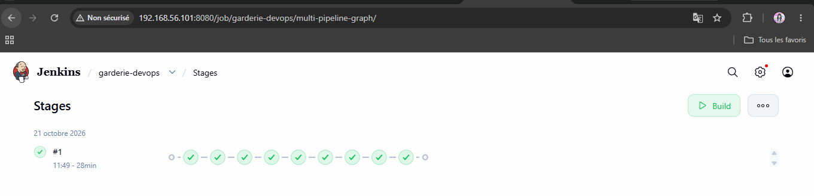
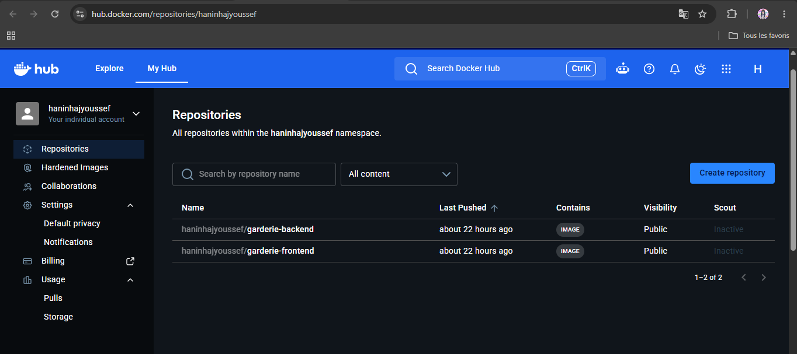
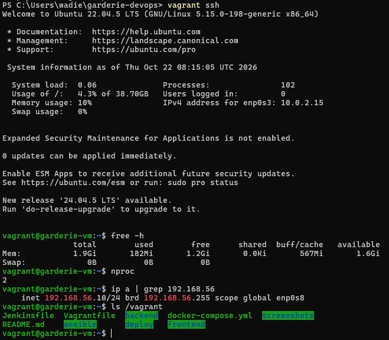
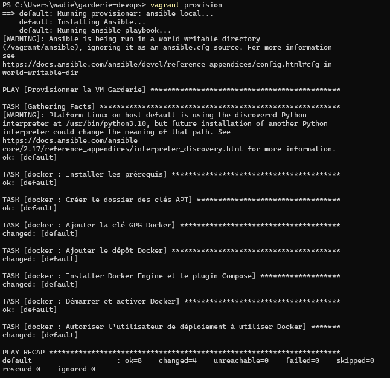
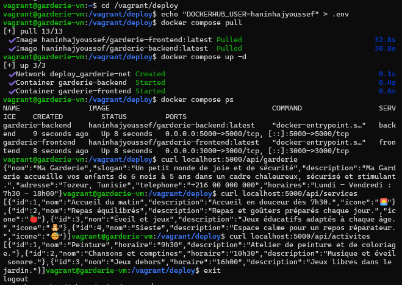
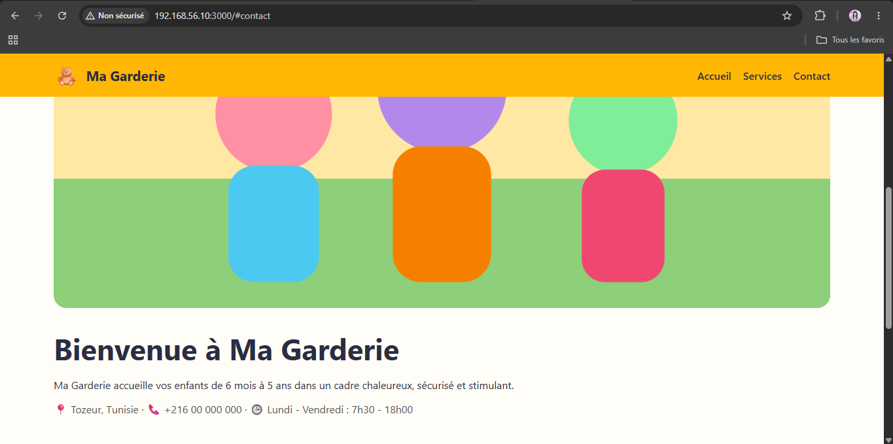
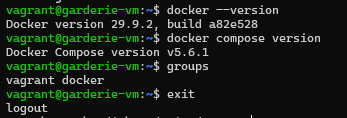

# Ma Garderie — DevOps (Jenkins · Docker · Vagrant · Ansible)

## 1. Présentation
Landing page responsive pour une garderie : frontend **Next.js** (Navbar, Hero, Services) + backend **Node.js/Express** (`/api/garderie`, `/api/services`, `/api/activites`).

## 2. Architecture
```
Navigateur ──► Frontend Next.js :3000 ──(proxy /api)──► Backend Express :5000
GitHub â–º Jenkins (Checkout, Install, Test, Build, Push) â–º Docker Hub â–º VM Vagrant (Docker via Ansible) â–º docker compose
```

## 3. Création et provisioning de la VM
```bash
vagrant up            # crée la VM Ubuntu (2 Go, 2 vCPU, 192.168.56.10) + lance Ansible
vagrant ssh           # vérification SSH
docker --version && docker compose version
```

## 4. Pipeline Jenkins
Pipeline as Code (`Jenkinsfile`). Credentials Docker Hub : id `dockerhub-credentials`.
Étapes : Checkout → Install → Test → Build Frontend → Build Backend → Push Frontend → Push Backend.

## 5. Images Docker Hub
- Frontend : https://hub.docker.com/r//garderie-frontend
- Backend : https://hub.docker.com/r//garderie-backend

## 6. Déploiement (dans la VM)
```bash
cd /vagrant/deploy
cp .env.example .env     # mettre votre user Docker Hub
docker compose pull && docker compose up -d
docker compose ps
curl localhost:5000/api/garderie
```

## 7. Accès
http://192.168.56.10:3000

## 8. Captures d'écran









